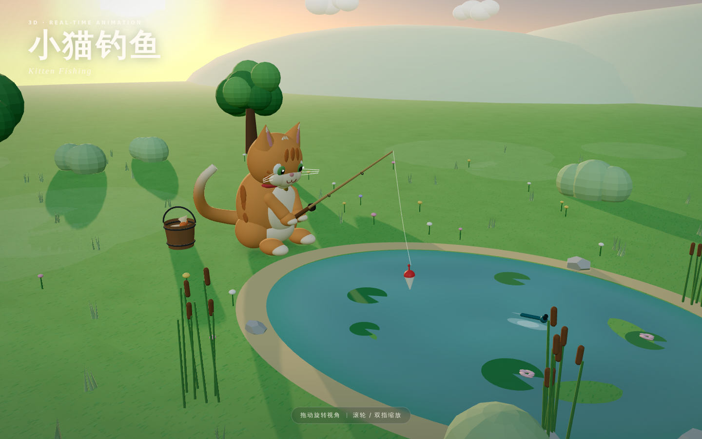

# Bently
hello agent

## 安装

```bash
sudo apt update && sudo apt install -y git
```

## 三维小猫钓鱼动画

一个用 Three.js 制作的三维实时动画：橘猫坐在夕阳下的池塘边垂钓，浮标随水波轻轻起伏；每隔 16 秒，小鱼会咬钩、跃出水面，小猫抬头张望、甩动尾巴。



[查看动画演示（GIF）](docs/screenshots/demo.gif)

### 运行

页面使用 ES Module，需要通过本地 HTTP 服务打开（直接双击 HTML 文件会被浏览器的模块安全策略拦截）：

```bash
python3 -m http.server 8000
```

然后访问 <http://localhost:8000/>。

### 操作

- 拖动：旋转视角
- 滚轮 / 双指捏合：缩放
- 双击：回到初始视角

### 结构

| 文件 | 说明 |
| --- | --- |
| `index.html` | 页面结构、标题与加载动画 |
| `src/main.js` | 渲染器、相机、灯光、交互和主循环 |
| `src/kitten.js` | 程序化小猫模型，以及呼吸、眨眼、摆尾、提竿动作 |
| `src/fishing.js` | 浮标、小鱼、水花、涟漪和钓鱼剧情 |
| `src/pond.js` | 池塘水面着色器、睡莲和蜻蜓 |
| `src/environment.js` | 天空、太阳、云、树木、花草与环境细节 |
| `vendor/three.module.min.js` | three.js r160（MIT，见 `vendor/THREE-LICENSE.txt`） |

所有模型均由几何体程序化生成，不依赖外部图片/模型资源；three.js 已本地化，离线打开也可以运行（仍需本地 HTTP 服务）。
